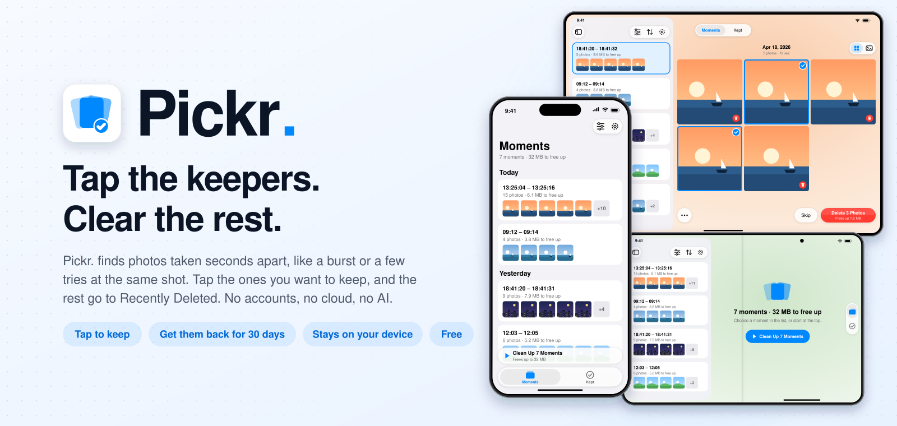
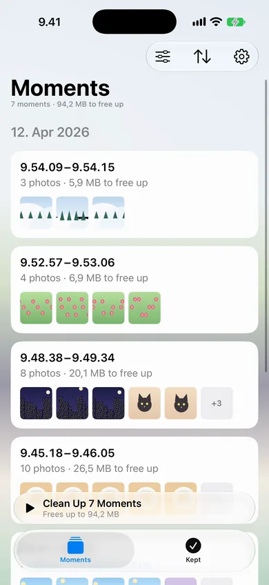
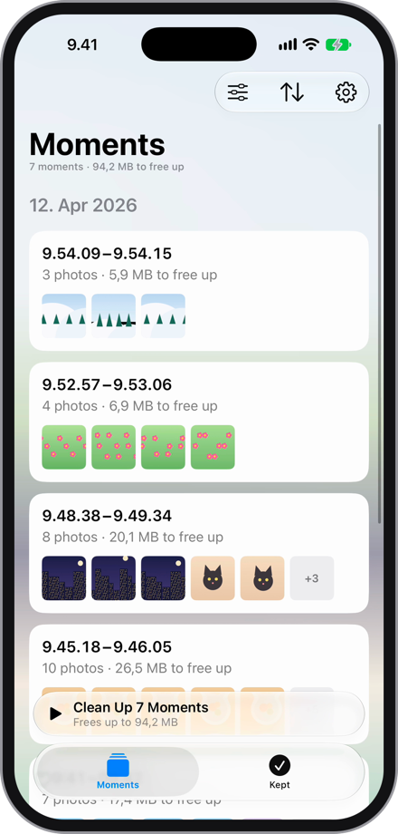
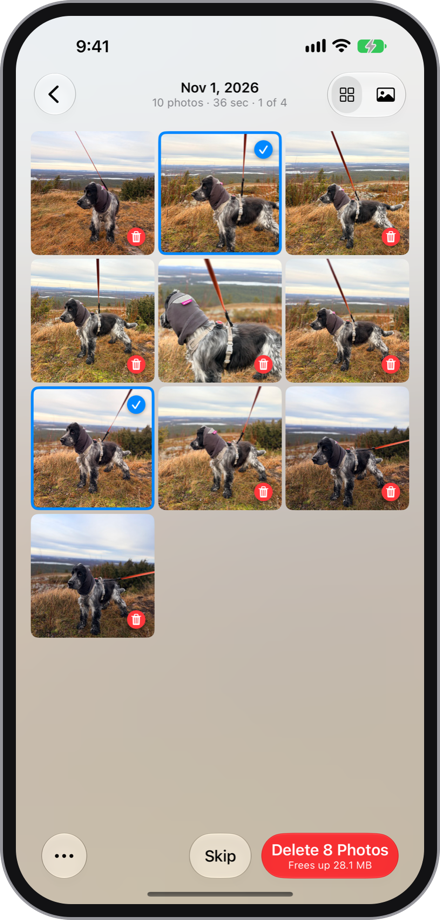
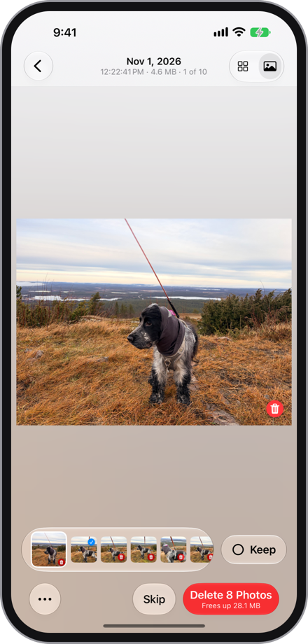
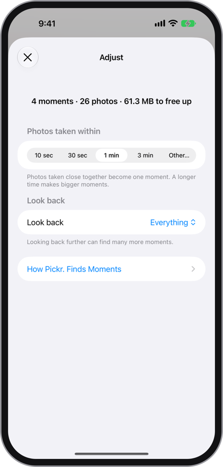
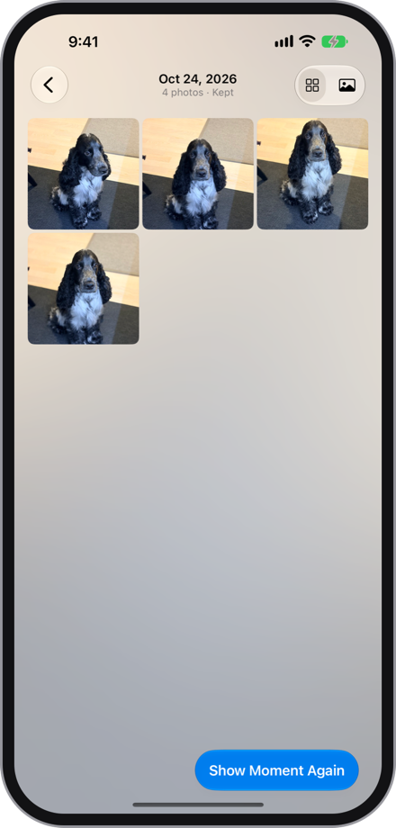

<p align="center">
  <picture>
    <source media="(prefers-color-scheme: dark)" srcset="images/brand/banner-dark.svg">
    
  </picture>
</p>

<p align="center">
  <b>The fastest way to clear out bursts and repeat shots from your photo library.</b><br>
  Pickr. finds photos taken seconds apart, like a burst or a few tries at the same shot, and puts each set together as a moment. Tap the ones you want to keep, and the rest go to Recently Deleted in one go, where you can get them back for 30 days. Everything happens on your device: no accounts, no cloud, no AI.
</p>

<p align="center">
  <a href="https://apps.apple.com/us/app/pickr/id6762475298"></a>
  
  
  
  
  <a href="LICENSE"></a>
  
</p>

<p align="center">
  <a href="https://apps.apple.com/us/app/pickr/id6762475298"><b>Get Pickr. on the App Store</b></a> · iPhone with iOS 27 or later · <a href="privacy.md">Privacy policy</a> · <a href="#support">Support</a>
</p>

---

## Why Pickr.

One sunset, eleven shots. The kids jumping off the dock, a burst of thirty. Your camera roll fills up with photos that look almost the same, and clearing them out in Photos means opening each one, comparing, picking and deleting, over and over.

- **The repeats are scattered.** They sit between everything else you took that day, so you never see them side by side.
- **Choosing is slow.** Picking the bad ones one at a time is the opposite of how you think: you know which one you *want*.
- **Deleting feels risky.** One wrong tap and a photo you cared about is gone.

Pickr. turns that around. It puts every burst in its own moment, you tap the keepers, and the rest go to Recently Deleted, so nothing is lost for 30 days.

<p align="center">
  <picture>
    <source media="(prefers-color-scheme: dark)" srcset="images/demo/hero.webp">
    
  </picture>
</p>

## How it works

1. Pickr. looks at when each photo was taken.
2. Photos taken within a short time of each other (1 minute unless you change it) become one **moment**.
3. You tap the photos you want to keep. Everything you didn't tap will be deleted.
4. You tap **Delete**, iOS asks once more, and the rest go to **Recently Deleted**, where you can get them back for 30 days. Pickr. then shows you the next moment.

Pickr. never looks at what's *in* your photos. No face recognition, no machine learning, no AI: just the time each photo was taken.

## Features

### Your camera roll, in moments

Moments are listed by day, newest first, or with the biggest ones at the top. Each card shows when the photos were taken, how many there are and how much space you could free up. Swipe a moment left to **Delete All**, or right to **Keep All** so it never comes back. **Clean Up 7 Moments** at the bottom takes you through them one after another.

<p align="center">
  <picture>
    <source media="(prefers-color-scheme: dark)" srcset="images/screens/framed/moments-dark.png">
    
  </picture>
</p>

### Tap the keepers

See the whole moment at once and tap the photos you want: a blue check marks each keeper, and a trash badge marks the ones that will go. Or look at them **One by One**, with a strip of thumbnails and a big **Keep** button. The red button always says how many photos you're deleting and how much space that frees up. **Skip** leaves a moment for later, and after each one Pickr. goes straight to the next.

<p align="center">
  <picture>
    <source media="(prefers-color-scheme: dark)" srcset="images/screens/framed/review-grid-dark.png">
    
  </picture>
  <picture>
    <source media="(prefers-color-scheme: dark)" srcset="images/screens/framed/review-single-dark.png">
    
  </picture>
</p>

### Adjust what counts as a moment

Tap **Adjust** to choose how close together photos need to be: **Photos taken within** 10 sec, 30 sec, 1 min, 3 min, or any time up to 2 hours. **Look back** a week, 2 weeks, a month, through everything, or pick the dates yourself. The list updates behind the sheet as you change it, with a live count of moments, photos and space to free up.

<p align="center">
  <picture>
    <source media="(prefers-color-scheme: dark)" srcset="images/screens/framed/adjust-dark.png">
    
  </picture>
</p>

### Kept means kept

Moments you keep go to the **Kept** tab and won't come back for cleanup. The photos you kept while deleting the rest of a moment wait under **Photos you picked**. Changed your mind? **Show Again** puts a photo, a moment or everything back in Moments.

<p align="center">
  <picture>
    <source media="(prefers-color-scheme: dark)" srcset="images/screens/framed/kept-dark.png">
    
  </picture>
</p>

### Your photos in the background

Behind the list, each moment's photo sits softly blurred behind its card and scrolls with it, blending into the next, and the Liquid Glass controls above pick up its colours. Inside a moment, the photo you're looking at fills the background. It's a blurred tiny copy made on your device, not AI, and it switches off when Reduce Transparency or Increase Contrast is on.

### Safe by design

- **Favorites are never deleted.** Photos you marked as favorites or rated start as kept, and Delete All skips them. You can turn off **Never delete favorites** in Settings.
- **iOS asks before every delete,** and deleted photos stay in Recently Deleted for 30 days. Deleting 20 photos or more at once asks one more time.
- **Undo** for everything that doesn't delete: Keep All and Show Again.
- **Hidden photos are never touched,** and Pickr. checks each photo again right before it's deleted.
- **Your progress:** Settings counts the photos you've deleted, the space you've freed up and the moments you've done.

### New in 2.0

Pickr. 2.0 is rebuilt from the ground up for iOS 27 and Liquid Glass. Kept has its own tab, Pickr. moves on to the next moment by itself, changes in Adjust show up instantly, favorites are never deleted, your photos fill the background, softly blurred, and you can undo anything that isn't a delete. Your settings, your progress and the photos you kept carry over from 1.0.

## Privacy

Pickr. is built so that your photos never leave your device.

- **No servers.** Pickr. itself never connects to the internet. If you use iCloud Photos, iOS may download a photo from iCloud when Pickr. shows it.
- **No analytics, tracking, ads or third-party code,** and no account or sign-in. The App Store label is "Data Not Collected".
- **No AI.** No face recognition, machine learning or image analysis. Pickr. reads when each photo was taken and last edited, whether it's a favorite or rated, its file size and its ID, and opens images only to show them to you.
- **Deleting always goes through iOS,** which asks you first and puts the photos in Recently Deleted.
- **What's stored stays on your device:** your settings, your progress, the list of photos you kept, and a cache that helps Pickr. open quickly. Deleting the app removes it all.

Read the full policy: [privacy.md](privacy.md). Pickr. is open source, so you can check every line of it.

## Support

Found a bug, or have an idea? Email **54-onrush-clones@icloud.com**, or [open an issue](https://github.com/YlitaloJuha/pickr/issues) (please don't attach your own photos).

**Changed your mind about a photo?** Open Photos → Albums → **Recently Deleted** and choose the photos you want back. iOS keeps them for 30 days.

**A photo isn't in any moment?** A moment needs at least two photos taken close together. In **Adjust**, choose a longer time under **Photos taken within**, or look back further. Photos you kept, hidden photos and the extra shots inside a burst (Pickr. uses the one Photos shows) aren't included.

**Pickr. can see only some of your photos?** Tap **Choose Photos** at the top of the Moments list, or change it in Settings → Apps → Pickr. → Photos.

## Build from source

You need a Mac with Xcode 27.2 and [XcodeGen](https://github.com/yonaskolb/XcodeGen) (`brew install xcodegen`). There are no other dependencies.

```sh
git clone https://github.com/YlitaloJuha/pickr.git && cd pickr
scripts/bootstrap.sh            # creates Config/Signing.local.xcconfig and generates Pickr.xcodeproj
open Pickr.xcodeproj
```

- **Signing stays out of git.** To run on your own device, put your team ID in `Config/Signing.local.xcconfig` (git-ignored; `bootstrap.sh` copies it from the `.example` file, which shows the format), and give your build its own bundle ID there: `PICKR_BUNDLE_ID = com.example.pickr`. Don't pick a team in Xcode's Signing tab; it writes it into the project.
- **Tests:** most of the logic lives in the `PickrKit` package and tests on the Mac with `cd PickrKit && swift test`. `scripts/policy-check.sh` runs the privacy and code-rule checks that CI runs.
- **Test photos:** `test-photos/` holds 40 synthetic photos. Load them into a simulator with `xcrun simctl addmedia booted test-photos/*.jpg`.
- `Pickr.xcodeproj` is generated: change `project.yml` instead.

How it fits together: [docs/ARCHITECTURE.md](docs/ARCHITECTURE.md). The stored data that upgrades depend on: [docs/PERSISTENCE.md](docs/PERSISTENCE.md).

## Contributing

Bug reports and ideas are welcome as [issues](https://github.com/YlitaloJuha/pickr/issues). How to build, test and send a change, and the rules that keep Pickr. private: [CONTRIBUTING.md](docs/CONTRIBUTING.md). Found a security problem? Please report it privately, as [SECURITY.md](docs/SECURITY.md) explains.

## No warranty

Pickr. is free software, provided **as is**, without any warranty, and you use it at your own risk. The author isn't liable for anything that happens because you used it, including photos you chose to delete. The [MIT licence](LICENSE) says this in legal terms, and it is what applies.

Pickr. deletes only the photos you confirm, and iOS keeps them in Recently Deleted for 30 days. After that, or if you empty Recently Deleted, they're gone. Keep a backup of photos that matter.

## Disclaimer

Pickr. is an independent project and is not affiliated with or endorsed by Apple. iPhone, iOS, iCloud and App Store are trademarks of Apple Inc.

## Licence

The source code is [MIT](LICENSE) © 2026 Juha Ylitalo.

**Name and artwork.** The Pickr. name, app icon, screenshots and the artwork in `images/` aren't covered by the MIT licence. Forks that ship to the App Store must use their own name, icon and bundle ID. See [NOTICE](NOTICE).
